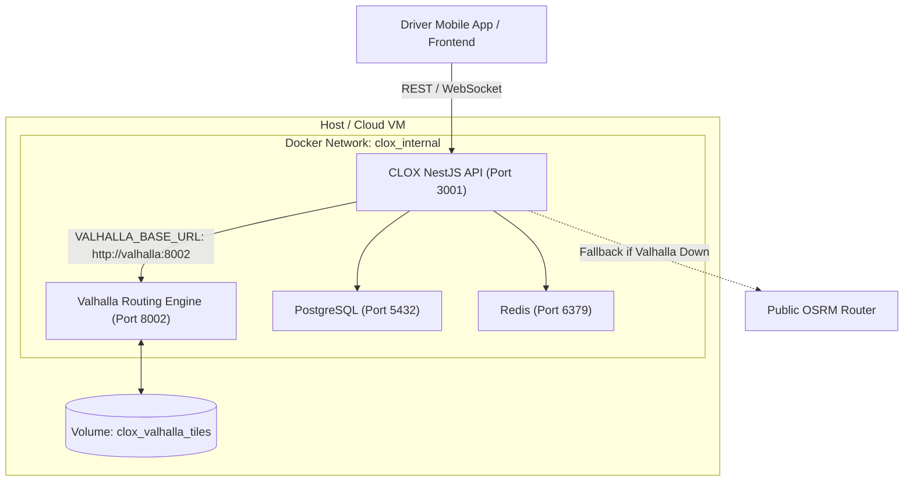

# CLOX Backend & Valhalla Production Deployment Guide

This guide is for developers and DevOps engineers taking the `feat/geofence-valhalla` branch to staging/production environments.

---

## 1. Quick Answer: Does Valhalla Auto-Deploy?

**No, Valhalla does NOT auto-deploy as part of the standard Node.js app build.**

* **Why?** Valhalla is a high-performance C++ routing engine running inside a separate Docker container (`ghcr.io/gis-ops/docker-valhalla/valhalla:latest`).
* On initial setup, it downloads Australia-Oceania OpenStreetMap (OSM) data (~1.5GB) and builds spatial routing tiles on disk (~10–15 min).
* **Tile Persistence:** The tiles are stored in a Docker named volume (`clox_valhalla_tiles`). Once built, container restarts are **instant** (under 3 seconds).
* **Zero-Downtime Resilience:** If Valhalla is ever offline or building tiles, the backend **automatically falls back** to road routing via OSRM (`https://router.project-osrm.org`) so client requests never fail.

---

## 2. Architecture & Networking Overview



---

## 3. Step-by-Step Deployment Instructions

### Phase 1: Deploy Valhalla (One-Time Setup per Server)

1. **Verify Docker & Docker Compose are installed on the server:**
   ```bash
   docker --version
   docker compose version
   ```

2. **Ensure the internal network exists:**
   ```bash
   docker network create clox_internal || true
   ```

3. **Navigate to the Valhalla Docker directory:**
   ```bash
   cd backend/docker/valhalla
   ```

4. **Start Valhalla in the background:**
   ```bash
   docker compose -f docker-compose.valhalla.yml up -d
   ```

5. **Monitor the initial tile build:**
   ```bash
   docker logs -f clox_valhalla
   ```
   * *First run:* Takes ~10–15 minutes while it downloads `australia-oceania-latest.osm.pbf` and builds routing tiles.
   * Look for: `Valhalla server started on port 8002` or `Valhalla is ready`.
   * *Subsequent runs:* Takes < 5 seconds because tiles are cached in the volume `clox_valhalla_tiles`.

6. **Verify Valhalla Healthcheck:**
   ```bash
   curl http://localhost:8002/status
   # Expected response: {"status":"OK","version":"..."}
   ```

---

### Phase 2: Deploy the Backend API (`clox-api`)

1. **Pull the latest code on your branch:**
   ```bash
   git checkout feat/geofence-valhalla
   git pull origin feat/geofence-valhalla
   ```

2. **Install dependencies:**
   ```bash
   cd backend/cloxbackend
   npm ci
   ```

3. **Configure Environment Variables (`.env`):**
   Ensure the following new variables are configured:

   | Variable | Production Value (Containerized) | Production Value (Bare VM) | Description |
   | :--- | :--- | :--- | :--- |
   | `VALHALLA_BASE_URL` | `http://clox_valhalla:8002` | `http://localhost:8002` | Valhalla HTTP base URL |
   | `VALHALLA_TIMEOUT_MS` | `5000` | `5000` | Max wait time before OSRM fallback |
   | `VALHALLA_COSTING` | `truck` | `truck` | Vehicle profile (`truck`, `auto`) |
   | `WS_CORS_ORIGIN` | `https://your-frontend-domain.com` | `*` | Allowed WebSocket origins |

4. **Run Database Migrations:**
   ```bash
   npx prisma migrate deploy
   ```

5. **Build the NestJS Application:**
   ```bash
   npm run build
   ```

6. **Start the Production Process (PM2 / Systemd / Docker):**
   * **Using PM2:**
     ```bash
     pm2 start dist/main.js --name "clox-api" --instances max --exec-mode cluster
     pm2 save
     ```
   * **Using Systemd or standard Node:**
     ```bash
     npm run start:prod
     ```

---

## 4. Verification Checklist for the Next Developer

Once deployed, run these commands to ensure everything is operating correctly:

### Test 1: Check Valhalla Direct
```bash
curl "http://localhost:8002/status"
```
**Expected:** `{"status":"OK", ...}`

---

### Test 2: Road Route Endpoint (Valhalla / OSRM)
```bash
curl -s "http://localhost:3001/v1/geolocation/route?fromLat=-37.8136&fromLng=144.9631&toLat=-37.823&toLng=144.998"
```
**Expected Response:**
```json
{
  "source": "valhalla",
  "encodedPolyline": "...",
  "distanceKm": 3.9,
  "durationMin": 7
}
```
*(Note: If Valhalla is still downloading tiles, `source` will be `"osrm"`, which is expected and graceful).*

---

### Test 3: Realtime Tracking WebSocket
Connect a WebSocket client to `ws://<domain>:3001/tracking` or via the mobile driver app.
* Send location ping event.
* Check that backend geofence triggers automatically at pickup/dropoff zones.

---

## 5. Summary Table for CI/CD Deployment

| Component | Auto-Deployed via CI/CD? | Deployment Tool | Frequency |
| :--- | :--- | :--- | :--- |
| **`clox-api` (NestJS)** | **Yes** | Docker / PM2 / GitHub Actions | Every commit / PR merge |
| **`clox_valhalla` (Engine)** | **No** (Infrastructure) | `docker-compose.valhalla.yml` | Once per environment setup |
| **Prisma Migrations** | **Yes** (`prisma migrate deploy`) | CI/CD pipeline | On schema change |
